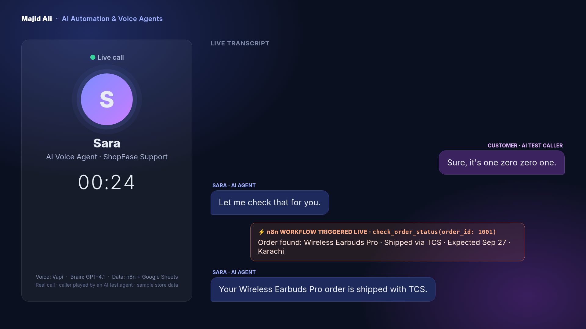

# AI Voice Agent for E-commerce Order Status Calls (Vapi + n8n + OpenAI)

An AI phone agent for online stores: the voice assistant ("Sara", running on Vapi) answers the call, asks for the order number, checks it live through an n8n webhook against a Google Sheet of orders, and tells the caller the status. It can also log return requests, and after each call n8n saves an AI summary of the call to Google Sheets.

> **DEMO:** built with sample store data in Google Sheets (the caller in the demo is an AI test caller). No real customers or client data are involved, and all API keys, IDs and credentials have been replaced with `YOUR_...` placeholders.

## What it does

- Answers store phone calls 24/7 with a natural-sounding AI voice agent (Vapi)
- **Order status**: looks up the order live and reads back items, total, status, courier, tracking number and expected delivery
- **Returns**: checks eligibility (only delivered orders) and logs a return request with a request ID in a *Returns* tab
- **After the call**: OpenAI extracts customer name, order ID, intent, resolved yes/no and a 2-sentence summary from the transcript, saved with duration, cost, end reason and recording link in a *Calls* tab
- Never invents values: unknown orders get a "please repeat the order number" response

## How it works

1. **Vapi Ecom Webhook** (POST `/webhook/vapi-ecom`) is the Vapi server URL. Vapi calls it during the call for tool calls and at the end with the end-of-call report.
2. **Is Tool Call?** checks `message.type == "tool-calls"`.
   - **Yes:** **Read Orders** (Google Sheets, *Orders* tab) → **Handle Tool Call** (Code) runs `check_order_status` or `request_return` and builds the results → **Answer Vapi** responds to Vapi with the tool results → **New Return?** → **Return Rows** → **Add to Returns Sheet**.
   - **No:** **OK** acknowledges the event → **Is End Of Call Report?** → **Parse Call Report** (transcript, duration, cost, end reason, recording URL) → **AI Call Summary** (OpenAI `gpt-4.1-mini`, JSON mode) → **Build Call Row** → **Add to Calls Sheet**.

## Tech stack

`Vapi` · `n8n` · `OpenAI (gpt-4.1-mini)` · `Google Sheets` · `Webhooks` · `JavaScript`

## How to import into n8n

1. **Workflows → Import from File** → [`workflow/ai-voice-agent-order-status-vapi.json`](workflow/ai-voice-agent-order-status-vapi.json).
2. Create a Google Sheet with three tabs:
   - **Orders**: `Order ID, Customer Name, Product, Quantity, Amount, Order Date, Status, Courier, Tracking Number, Expected Delivery, City`
   - **Returns**: `Request ID, Received At, Order ID, Customer Name, Caller Phone, Reason, Status`
   - **Calls**: `Received At, Call ID, Caller Phone, Customer Name, Order ID, Intent, Resolved, Summary, Duration (sec), Cost ($), Ended Reason, Recording URL`
3. In **Read Orders**, **Add to Returns Sheet** and **Add to Calls Sheet**, replace `YOUR_SHEET_ID` with your sheet ID.
4. Create and select these credentials:
   - **Google Sheets OAuth2** → the three Google Sheets nodes
   - **OpenAI API** → *AI Call Summary*
5. Activate the workflow and copy the **Production URL** of *Vapi Ecom Webhook*.
6. In **Vapi**, create an assistant (system prompt, voice and an OpenAI model of your choice) and add two function tools that point to that URL:
   - `check_order_status` with the parameter `order_id`
   - `request_return` with `order_id`, `customer_name`, `reason`
   Set the same URL as the assistant's **Server URL** so the end-of-call report is sent to n8n, then attach a phone number.
7. The workflow timezone and timestamps are set to `Asia/Karachi` (PKT); change them in workflow settings and the two Code nodes if you need another timezone.

## Need this for your store?

I'm **Majid Ali**, founder of **[Ecom Agent Lab](https://ecomagentlab.com)**. I build AI agents and n8n automations for UK Shopify and WooCommerce stores: WhatsApp agents, website chatbots, AI voice agents and back-office automations.

- 🌐 Website: [ecomagentlab.com](https://ecomagentlab.com)
- 📧 Email: [contact@ecomagentlab.com](mailto:contact@ecomagentlab.com)

I can set this up on your own store, connect it to your real data and adapt it to your policies and tone of voice.

## License

[MIT](LICENSE) © 2026 Ecom Agent Lab
